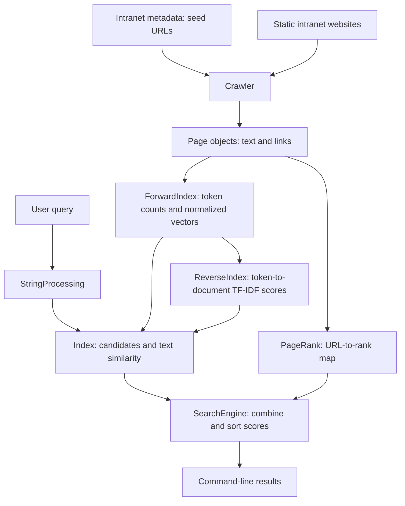

# Anguilla Search: Architecture

Anguilla Search is a Java search engine developed for the Programmierpraktikum at FernUniversität in Hagen in winter semester 2024/25. It searches a static intranet supplied for the course. Its main components collect website content, construct searchable indexes, compute link-based importance and rank results for queries entered through a command-line interface.

## 1. Overview

The application separates preparation from searching. Crawling, document indexing and PageRank computation are performed before the interactive search loop. The resulting data structures remain in memory and are reused for subsequent queries.



`AnguillaSearch` coordinates the application. `Crawler` retrieves pages, while `Page` stores their contents and links. The `Index` class provides access to the forward and inverted indexes. `SearchEngine` combines the index with PageRank and presents ranked results. Text preprocessing and vector operations are implemented separately so that the same transformations can be applied to documents and queries.

## 2. Crawling and page representation

The crawler begins with seed URLs. A FIFO queue stores URLs awaiting retrieval, and a map associates each successfully crawled URL with a `Page`. Before adding a discovered link to the queue, the crawler checks whether its target has already been retrieved or is already waiting. This prevents cycles in the link graph from repeatedly scheduling the same discovered page.

JSoup retrieves and parses each page. The crawler extracts the title, headings, paragraphs and outgoing links. Relative links are resolved against the page URL. Failed requests are logged, and processing continues with the remaining queue. The default crawl limit is 10,000 pages; a separate entry point accepts a smaller limit for the graph example.

A `Page` holds the text fields as strings and uses maps for incoming and outgoing links. Link maps associate a URL with an occurrence count, allowing callers to distinguish the number of different linked pages from the number of link occurrences. The page URL serves as its identifier throughout the application, connecting the text index, link graph and search results without a separate document-ID mapping.

Incoming links are populated after crawling. At that point, the crawler can identify which outgoing links point to pages in the retrieved collection. This second pass separates HTML extraction from construction of the internal link graph.

## 3. Text preprocessing and indexes

### Shared preprocessing

`StringProcessing` uses the CoreNLP pipeline for tokenization, sentence splitting, part-of-speech tagging and lemmatization. The resulting lemmas are converted to lowercase, and only those containing at least one ASCII letter are retained. Stopwords are then removed using the list in `src/main/resources/stopwords.txt`.

The same processing is used for website text and search queries. This keeps their token representations consistent: capitalization and inflected word forms do not require separate lookup rules. A frequency map records the number of occurrences of each remaining token.

### Forward index

`ForwardIndex` maps each document URL to its token-frequency map and normalized count vector. Text from the title, headings and paragraphs is concatenated before preprocessing; these fields are not assigned separate weights.

The vector is stored sparsely as a map from tokens to nonzero components. Missing tokens have value zero, so the implementation does not allocate an explicit component for every word in the collection. `NormalizedVector` divides the counts by their Euclidean norm. The resulting unit vectors support cosine similarity through a dot product.

### Inverted index and TF-IDF

`ReverseIndex` reverses the direction of lookup: each token maps to the URLs containing it and their TF-IDF weights. This makes it possible to find matching documents without scanning every document's text.

For token `t` in document `d`, the implementation computes:

```text
TF(t, d)     = count(t, d) / total token count(d)
IDF(t)       = ln(number of documents / documents containing t)
TF-IDF(t, d) = TF(t, d) * IDF(t)
```

For a query, `Index` gathers the documents containing at least one processed query token and sums their TF-IDF weights across the distinct query tokens. Repeating a token does not increase this TF-IDF sum. A token present in every indexed document has an IDF of zero, but the documents containing it are still included as candidates.

## 4. Text similarity and PageRank

### Cosine similarity

The cosine similarity compares the normalized token-count vector of a query with that of a document. Because both vectors have unit norm, their dot product gives the cosine similarity. The method iterates over query components and looks up the corresponding document components, avoiding a dense vocabulary-sized calculation.

These vectors use token counts, not TF-IDF weights. TF-IDF is maintained separately in the inverted index. Repeating one word relative to other words in a query changes the direction of its count vector and can therefore affect cosine similarity.

### Link-based importance

`PageRank` computes one rank per URL from the internal link graph. Each iteration derives new ranks from the previous iteration's values. A page's contribution is divided by its number of distinct outgoing links, and the contributions from incoming links are summed.

The damped version combines these contributions with a uniform rank source:

```text
new rank(d) = damping * incoming contributions(d)
              + (1 - damping) / number of pages
```

The search engine uses a damping factor of 0.85. Iteration stops when the sum of absolute rank changes falls below the configured tolerance, or when the maximum iteration count is reached. The algorithm also accepts a damping factor of 1 for the course comparison with undamped PageRank.

PageRank is computed once when the search engine is created. It provides a query-independent measure of link-based importance, complementing the query-dependent text similarity.

## 5. Ranking and query execution

For each query, the inverted index supplies the candidate URLs. `SearchEngine` obtains three values for each candidate: the query's TF-IDF sum, cosine similarity and PageRank.

Each metric is standardized within that query's candidate set by subtracting its mean and dividing by its population standard deviation. This puts metrics with different numerical ranges on a comparable scale. A metric with zero standard deviation contributes zero after centering. The combined score is a weighted average of the standardized metrics.

The default weights are:

| Metric | Weight |
| --- | ---: |
| TF-IDF sum | 0 |
| Cosine similarity | 1 |
| PageRank | 1 |

The default ranking therefore gives equal weight to standardized cosine similarity and PageRank. TF-IDF remains part of candidate retrieval and the displayed results. The alternative search entry point accepts weights explicitly, allowing the startup comparison to isolate TF-IDF and cosine similarity.

A `TreeSet` stores results in descending score order. When scores are identical, the URL determines the order, ensuring that different documents remain separate results. The output includes the URL, combined score and all three underlying metrics. Combined scores are relative to the candidate set and are not probabilities; negative scores are possible after standardization.

The command-line loop reuses the prepared indexes and ranks until the user enters `exit`. Unknown terms and empty queries produce an empty result table.

## 6. Startup and graph visualization

Before entering the interactive loop, `AnguillaSearch` creates a graph of a 16-page crawl of `cheesy4` and saves it to `figures/net-graph.png`. `NetworkGraph` uses JGraphX to represent pages as vertices and links between crawled pages as directed edges, arranged in a circular layout.

The application then compares TF-IDF-only and cosine-only rankings on `cheesy3` for three predefined queries. Finally, it collects seed URLs from the metadata for `cheesy1`, `cheesy2`, `cheesy3`, `cheesy4` and `cheesy6`, crawls these networks and initializes the interactive search engine. These preliminary graph and comparison steps explain why output appears before the first query prompt.

## 7. Verification and scope

The test suite checks crawling against the course metadata, TF-IDF calculations, cosine similarity, PageRank and retrieval of expected URLs. Additional tests check that equally scored documents are retained and that repeated vector comparisons preserve subsequent results. These checks pass with Java 17.

The architecture is intended for the supplied static intranet. Pages, indexes and ranks are held in memory and rebuilt on startup. It does not execute client-side JavaScript, interpret `robots.txt`, maintain a persistent index or redistribute PageRank from pages without outgoing links. These are relevant considerations for extending the application beyond its course environment.
