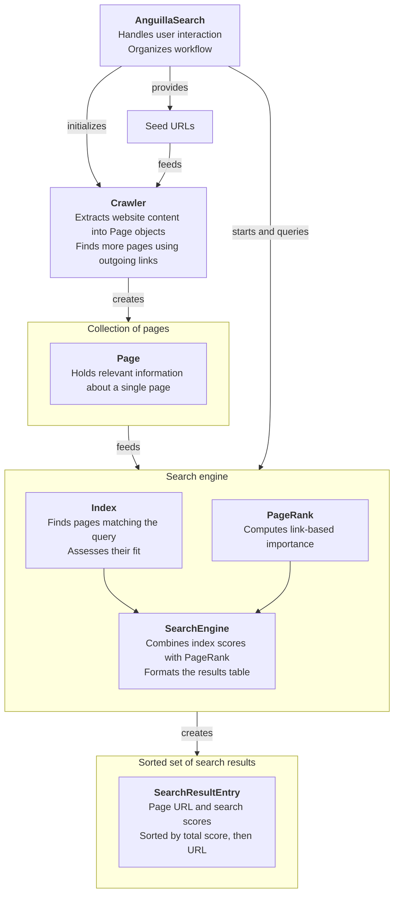

# Anguilla Search

Programmierpraktikum WS 2024/25, FernUniversität in Hagen

Alexander Greif

## Introduction

The assignments of this Programmierpraktikum constitute a sequence of steps to be followed for creating the Anguilla Search search engine. They also act as guidelines for the software design of the search engine. Figure 1 shows the structure of my implementation that resulted from following these guidelines. The diagram depicts the main components of my software, their main tasks and the interaction between them. In this document, I describe how these components work individually and together and explain their design decisions.



*Figure 1. Main components of my Anguilla Search implementation. Bold text represents classes.*

## Components

### The Page Data Structure

I will start with the Page data structure since it is central to a lot of the other classes' functionality and very straightforward. A Page contains a title, headings, paragraphs, outgoing links and incoming links. The first four are initialized during construction. Incoming links are added individually to an existing instance once the linked pages have been crawled. A Page also has methods to retrieve the information it stores.

The page URL identifies the page throughout the application. Incoming and outgoing links are stored as maps from URLs to occurrence counts. This allows the program to distinguish the number of different linked pages from the number of link occurrences. The title, headings and paragraphs can be retrieved together as a single string for text processing.

### The Crawler

A central component of the crawler is its queue of URLs of pages to be crawled. The queue is initialized with the provided seed URLs. The first item of the queue is retrieved, and the contents of the web page are parsed into a Page object, which is saved in a URL-to-Page map for easy access. Outgoing links that have not yet been parsed and are not in the queue are then added to it. Once the queue is empty, the crawler adds incoming links between the pages it has collected.

The queue is processed in first-in, first-out order. Checking both the map of collected pages and the queue prevents links forming a cycle from repeatedly scheduling the same discovered page. Incoming links are added in a separate pass because they depend on the outgoing links collected from other pages.

JSoup retrieves the HTML and extracts the title, headings, paragraphs and links. Relative links are resolved against the page URL. If a page cannot be retrieved, the failure is logged and the crawler continues. The default limit is 10,000 pages; a smaller limit is used for the network visualization.

### Text Processing

`StringProcessing` prepares both website text and search queries. It uses CoreNLP for tokenization, sentence splitting, part-of-speech tagging and lemmatization. Lemmas are converted to lowercase, and those without an ASCII letter are discarded. The stopwords listed in `src/main/resources/stopwords.txt` are then removed.

Using the same processing for documents and queries gives them a shared representation. For example, capitalization and inflected forms do not need separate lookup rules. The remaining tokens are counted and stored in a token-to-count map.

### The Forward and Reverse Indexes

The forward index organizes text by document: `ForwardIndex` maps each URL to its token counts and normalized TF-IDF vector. The title, headings and paragraphs are processed together, without separate weights for these fields.

The reverse index organizes documents by token: `ReverseIndex` maps each token to the URLs containing it and their TF-IDF values. It is built from the token counts in the forward index. This structure allows a query to retrieve matching pages without scanning every document's text.

For token `t` in document `d`, the weights are calculated as follows:

```text
TF(t, d)     = count(t, d) / total token count(d)
IDF(t)       = ln(number of documents / documents containing t)
TF-IDF(t, d) = TF(t, d) * IDF(t)
```

TF expresses a token's frequency relative to document length. IDF gives less weight to tokens appearing in many documents. Once the reverse index has calculated these weights, the forward index uses them to initialize the document vectors.

The simple TF-IDF search retrieves pages containing at least one query token and sums their TF-IDF values across the distinct query tokens. Repeating a word does not increase this sum. A token present in every document has IDF zero, but its pages are still included as candidates.

### Vector Representation and Cosine Similarity

`NormalizedVector` represents a vector as a map from tokens to nonzero components. A missing token has value zero. This sparse representation avoids allocating an entry for every token in the vocabulary for every document.

Document vectors contain TF-IDF weights and are normalized to a Euclidean norm of one. Query vectors use the same corpus IDF values, multiplied by the query token counts, and are normalized in the same way. Dividing query counts by the query length would scale every component equally and would therefore not change the normalized vector.

The cosine similarity of two nonzero unit vectors is their dot product. The implementation iterates over query components and looks up the corresponding document components. Document vectors are prepared during indexing, and the query vector is prepared once for the candidate set. Repeated searches therefore reuse the document vectors.

Repeating one query token relative to the others changes its weight and can influence the similarity. Tokens outside the vocabulary have weight zero. If all weights are zero, the vector remains empty and its similarity is defined as zero.

### PageRank

`PageRank` uses incoming and outgoing links to calculate one rank for each page. Ranks are initialized uniformly. In each iteration, a page receives contributions from pages linking to it; each contribution is divided by the source page's number of distinct outgoing links.

The damped version adds a uniform rank source:

```text
new rank(d) = damping * incoming contributions(d)
              + (1 - damping) / number of pages
```

The search engine uses a damping factor of 0.85. The algorithm stops when the sum of absolute rank changes falls below the configured tolerance, or when the maximum iteration count is reached. A damping factor of one is also supported for comparison with the undamped version.

PageRank is calculated once when the search engine is initialized. Its link-based importance is independent of the query and complements the text-based similarity.

### The Search Engine

`SearchEngine` combines the index and PageRank. For each query, it retrieves candidate URLs from the reverse index and obtains their TF-IDF sums, cosine similarities and PageRank values.

The three metrics have different numerical ranges. The program standardizes each metric within the candidate set by subtracting its mean and dividing by its population standard deviation. A constant metric contributes zero after centering. The combined score is a weighted average of these standardized values.

The default weights are zero for the separate TF-IDF sum and one each for cosine similarity and PageRank. The default ranking therefore combines TF-IDF cosine similarity with link-based importance. The TF-IDF sum remains available in the output and through the alternative search entry point, which accepts explicit metric weights.

Results are stored in a `TreeSet`, sorted by descending total score and then by URL when scores are equal. The URL comparison keeps different pages with identical scores in the result set. The displayed table contains the URL, total score and all three individual metrics. Total scores are relative to the query's candidate set and can be negative after standardization.

### Application Workflow and Visualization

`AnguillaSearch` coordinates startup and the command-line interface. Before the interactive loop, it creates a graph of a 16-page crawl of `cheesy4` and saves it to `figures/net-graph.png`. `NetworkGraph` uses JGraphX to draw pages as vertices and links as directed edges in a circular layout.

The application then compares TF-IDF-only and cosine-only searches on `cheesy3` for three predefined queries. For the interactive search, seed URLs are read from the metadata files for `cheesy1`, `cheesy2`, `cheesy3`, `cheesy4` and `cheesy6`. The crawler collects the pages, and the search engine prepares the indexes and ranks.

The application accepts further queries until the user enters `exit`. Pages, indexes and PageRank values remain in memory between queries. Empty queries and unknown terms produce an empty result table. Start and usage instructions are provided in the [README](../README.md).

## Verification and Scope

Tests check crawling against the course metadata, TF-IDF calculations, cosine similarity, PageRank and retrieval of expected URLs. Additional cases check equal-score results, repeated vector comparisons, TF-IDF weighting of documents and queries, and zero-weight vectors.

The implementation is designed for the supplied static intranet. It rebuilds its in-memory indexes on startup. Dynamic JavaScript content, a persistent index and handling of pages without outgoing links would require additional work for a broader web-search application.
